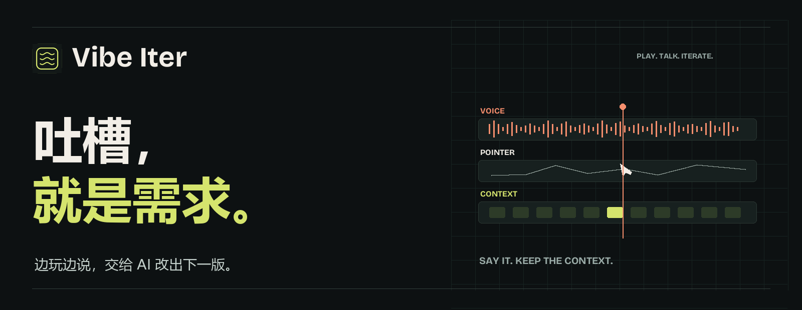
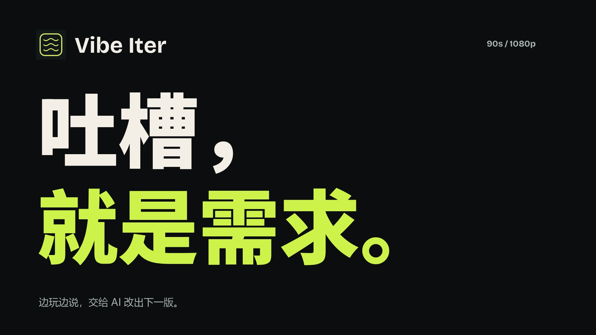

<div align="center">



**把使用时的每一句「这里不太对」，变成带上下文的迭代反馈。**

**[让 ZCode / Codex / WorkBuddy 帮你安装 ↓](#让-agent-帮你安装)**

[下载 Chrome 插件](https://github.com/fangkejustcan/Vibe-Iter/releases/latest/download/vibe-iter-chrome.zip) · [安装指南](docs/INSTALLATION.md) · [隐私说明](PRIVACY.md) · [参与贡献](CONTRIBUTING.md)

   [](LICENSE)

</div>

## 让 Agent 帮你安装

**第一次接触插件？把下面整段复制到 ZCode、Codex、WorkBuddy 等能操作本机文件的 coding agent。** 不需要先学 Git、Node.js 或命令行。


```text
请帮我在本机安装并试用 Vibe Iter：
https://github.com/fangkejustcan/Vibe-Iter

请先阅读 README、docs/AGENT-INSTALL.md 和 PRIVACY.md。
从最新 Release 下载 vibe-iter-chrome.zip 与 SHA256SUMS.txt，
校验后解压到新的固定目录，不覆盖已有文件，并告诉我完整路径。
若没有 Release，再检查 Node.js 20+，按文档下载源码并构建；
不要改动我的其他项目或全局配置。

帮我打开插件目录和 Chrome 的 chrome://extensions 页面，
引导我开启「开发者模式」→「加载已解压的扩展程序」。
加载确认和麦克风授权由我点击，不要装进临时测试浏览器。

再带我打开普通网页，开始测试，说话并操作，结束后播放录音，
导出完整包 ZIP，检查录音、截图和操作记录是否存在。
默认只安装录制功能，无需 Node.js、Python、服务器或云端 API。
转录服务未启动不代表录制失败；需要文字时再说明可选的本机 Whisper。
```

Agent 会完成下载、校验与解压；**Chrome 的加载确认和麦克风授权需要你亲自点击**。没有本机操作能力的聊天工具只能提供指导。[图文安装与排障 →](docs/AGENT-INSTALL.md)

## 90 秒，看一轮真实迭代

[](https://github.com/fangkejustcan/Vibe-Iter/raw/refs/heads/main/docs/assets/demo.mp4)

**[▶ 播放 / 下载 1080p 演示视频](https://github.com/fangkejustcan/Vibe-Iter/raw/refs/heads/main/docs/assets/demo.mp4)** · 90 秒 · 中文原声与字幕

试玩者说「这个可以按的，点击之后也没有效果」。Vibe Iter 留下当时的声音、鼠标目标、操作和截图。把完整包与项目一起交给 Codex 或其他 coding agent，让反馈对应到代码，再验证下一版。

## 先用起来，再说感受

| 01 · 开始 | 02 · 试玩 | 03 · 交接 |
| --- | --- | --- |
| 打开网页和插件侧栏，点击「开始测试」。 | 正常操作，自然说出意见。侧栏可以关闭。 | 结束测试，导出 ZIP，与项目一起交给 coding agent。 |

- **原声一直在。** 持续录制麦克风，约每秒保存音频，转录失败也能播放和导出。
- **「这个」有上下文。** 保存鼠标坐标、DOM 目标、点击和键盘事件，关联采样截图。
- **一轮意见，一次交接。** ZIP 保留完整录音、操作、截图，以及已有的转录和反馈。
- **数据保存在本机。** 没有账号、遥测或云端录音上传；详情见[隐私说明](PRIVACY.md)。

## 安装：下载，解压，加载

1. [下载 `vibe-iter-chrome.zip`](https://github.com/fangkejustcan/Vibe-Iter/releases/latest/download/vibe-iter-chrome.zip)，解压到一个固定文件夹。
2. 打开 `chrome://extensions`，开启右上角「开发者模式」。
3. 点击「加载已解压的扩展程序」，选择含 `manifest.json` 的文件夹。
4. 固定 Vibe Iter 图标，打开要测试的 HTTP/HTTPS 网页；首次使用先允许麦克风。

**录音、操作采集、截图、播放和导出不需要启动服务器。** 当前版本的语音转文字使用可选的本机 Whisper 服务；安装方式见下方。浏览器内模型尚未集成。

这不是 Chrome 商店一键安装包；Chrome 不支持直接安装普通 ZIP。无需 Node.js 或 Python 即可使用录制功能。

## 可选：本机语音转文字

需要 Python 3.10+。下载本项目源码后，在项目目录执行：

```bash
python -m pip install -r scripts/requirements-voice.txt
python -c "from faster_whisper import WhisperModel; WhisperModel('small', device='cpu', compute_type='int8')"
python scripts/transcription_server.py
```

首次下载模型需要网络；之后服务只使用本机缓存，监听 `127.0.0.1:4318`。macOS / Linux 若没有 `python` 命令，改用 `python3`。

结束录制后会自动尝试转录。服务没启动也不会丢失已保存的录音；稍后启动它，再点「转录整场 / 重试」。转录与时间关联可能有误，重要内容请核对原音。

## 交给 coding agent 的内容

```text
playtest/
├── audio.webm       # 完整原始录音
├── session.json     # 时间、目标、操作、截图与已有转录
├── report.md        # 反馈与完整操作时间线
├── screenshots/    # 采样画面
└── README.txt
```

没有完整音频时，导出包附 `AUDIO-MISSING.txt`，不会用空音频掩盖缺失。提交报告前请检查 ZIP 的实际内容。

可以这样交接：

> 请结合这个试玩包的原音、操作和截图，分析对应项目。先列出带时间点的反馈，区分原话与推测，再结合代码提出修改方案。不要只因为 report.md 没有转录就认为没有意见。

## 使用边界

- 记录原测试标签页；同一标签页刷新、导航会继续，其他标签页不会自动加入。
- 鼠标移动和滚动约 100ms 采样；画面约每 5 秒及关键操作采样。**不是连续屏幕录像。**
- iframe 内部事件、Canvas 内部对象和游戏状态不直接采集，需要结合截图和代码判断。
- 录制会保存页面文本、普通输入和 URL；密码字段的输入值与键值会隐藏，但截图不自动打码。请在测试环境使用。
- 浏览器关闭会中断录制。重开后可恢复已提交的数据，最后约 1 秒可能丢失。卸载扩展会删除浏览器中的本地记录，请及时导出。

## 自己构建

需要 Node.js 20+：

```bash
npm ci
npm run package
```

输出：`release/vibe-iter-chrome.zip` 和 `release/SHA256SUMS.txt`。ZIP 只包含插件运行文件与许可证，不包含测试游戏、源码、个人录音或制作素材。

```bash
npm run dev -- --host 127.0.0.1 --port 4317
```

打开 `http://127.0.0.1:4317/game.html` 可体验演示游戏「潮汐邮局」。开发服务只用于开发和演示，已安装插件无需运行它。

[开发与测试](docs/DEVELOPMENT.md) · [架构](docs/ARCHITECTURE.md) · [发行流程](docs/RELEASING.md) · [使用须知](docs/USER-NOTES.md)

---

源代码采用 [MIT License](LICENSE)。演示视频及第三方组件的许可范围见 [Third-Party Notices](THIRD_PARTY_NOTICES.md)。Vibe Iter 是独立开源项目，与 OpenAI、Google 无隶属关系。
