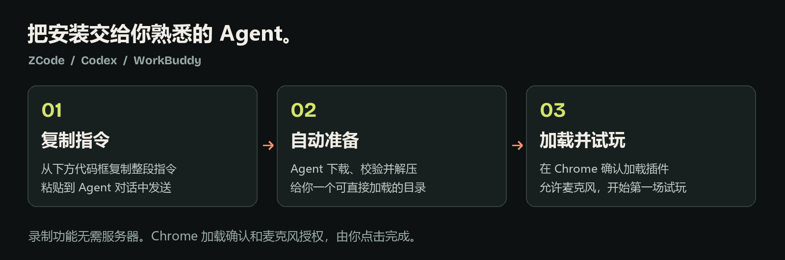

# 让 coding agent 帮你安装与开始使用

适用于 ZCode、Codex、WorkBuddy 等可以下载文件、操作本机目录和运行命令的工具。不同工具的能力与界面可能不同。没有本机权限的聊天窗口无法代你安装。



## 1. 复制首页指令

在你的 Agent 中打开一个普通工作目录，把 [首页「让 Agent 帮你安装」](../README.md#让-agent-帮你安装) 中的整段指令粘贴进去并发送。你无需预先下载源码或学习命令行。

默认安装录制功能，只需 Chrome 116+。下载需要网络；安装后录音、操作、截图、播放与导出都不依赖开发服务器或 Python。语音转文字是单独的可选功能。

## 2. Agent 自动准备文件

供 Agent 执行：

1. 只从 `https://github.com/fangkejustcan/Vibe-Iter` 获取本项目，阅读 README 和隐私说明。
2. 最新发行版固定入口：

   - 插件：`https://github.com/fangkejustcan/Vibe-Iter/releases/latest/download/vibe-iter-chrome.zip`
   - 校验：`https://github.com/fangkejustcan/Vibe-Iter/releases/latest/download/SHA256SUMS.txt`

3. 下载后先检查 HTTP 是否成功，避免把 GitHub 错误页面当作 ZIP。计算 ZIP 的 SHA-256，与校验文件中 `vibe-iter-chrome.zip` 对应的值比较；不一致时停止安装。
4. 选择新的永久目录，例如用户自选的应用目录中的 `Vibe-Iter`。目录已存在时保留它并选择新目录，不覆盖旧安装或用户数据。解压前检查条目没有绝对路径或 `..` 路径穿越。
5. ZIP 根目录应有 `manifest.json`，其 `name` 为 `Vibe Iter`、`manifest_version` 为 `3`；应包含侧栏、后台脚本和图标。不要加载下载目录中不相关的扩展。
6. 若尚无 Release，可将公开源码下载到新目录，先检查 Node.js 20+，运行 `npm ci` 和 `npm run package`。使用新生成的 `release/vibe-iter-chrome.zip` 或 `dist/`。缺少 Node.js 时向用户解释需要安装的依赖，不擅自改全局环境。
7. 给用户展示插件目录的**完整路径**，打开该目录及 Chrome 的 `chrome://extensions` 页面；无法自动打开时，给出可复制的路径和地址。

不要求用户把 GitHub Token、云端 API 密钥或真实录音发到聊天中。不要更改 Chrome 的安全策略、注册表、现有浏览器配置或其他扩展，也不要把扩展误装进 Agent 的临时浏览器。

## 3. 在你平时使用的 Chrome 中确认

Chrome 不能直接把普通 ZIP 安装成扩展。请在自己的日常 Chrome 中完成：

| 页面位置 | 你要做什么 | 成功标志 |
| --- | --- | --- |
| `chrome://extensions` 右上角 | 打开「开发者模式」 | 出现「加载已解压的扩展程序」 |
| 页面左上角 | 点击「加载已解压的扩展程序」，选择 Agent 给出的文件夹 | 扩展列表出现 **Vibe Iter** |
| 浏览器右上角的拼图图标 | 将 Vibe Iter 固定到工具栏，点击它 | 右侧打开 Vibe Iter 侧栏 |
| 侧栏中的「麦克风授权与设备测试」 | 点击授权，在 Chrome 提示中允许麦克风 | 页面提示麦克风已授权 |

选择的文件夹应直接包含 `manifest.json`，不要选择 ZIP 本身或其上一级目录。保留解压目录，Chrome 后续仍需读取它。

## 第一次试玩：一分钟检查

1. 打开一个普通 HTTP/HTTPS 网页，例如自己的测试项目。不要使用 `chrome://` 页面、Chrome 商店或真实账号、付款、密钥页面。
2. 打开侧栏，输入项目名称，点击「开始测试」。等待「录音已验证」，确认说话时音量条有变化。
3. 正常操作网页并说一句意见，例如「这个按钮点下去没有反馈」。可以关闭侧栏，录音会继续。
4. 重新打开侧栏，点击「结束测试」，播放音频，确认能听到刚才的话。
5. 点击「导出完整包 ZIP」，保存到自己的目录。检查包中有可播放的 `audio.webm`、`session.json`、`report.md` 与 `screenshots/`。

没有启动 Whisper 时，语音转文字可能提示失败，但原始录音仍应可以播放、导出。无需为此反复录制。需要文字时再按 [首页的 Whisper 配置](../README.md#可选本机语音转文字) 操作，并保持本机转录服务运行。

## 把反馈交回 Agent

把导出的 ZIP 放进项目工作目录，并发送：

```text
请结合这个 Vibe Iter 试玩包和当前项目分析问题。先读取 README.txt、session.json 和 report.md，结合截图、操作时间线以及已有转录列出带时间点的反馈，区分原话与推测。
如果没有转录，不要把它理解成没有意见；先检查原始音频。若你不能读取音频，请明确告诉我，再引导我使用可选的本机 Whisper 服务转录。
随后结合代码定位问题，提出修改方案并按我的工作方式实现；修改后运行项目已有检查，并告诉我如何复测。
```

Agent 不一定能直接听取音频，具体取决于工具与模型。提交前请检查试玩包中是否包含私人声音、页面内容、URL 或截图。

## 常见问题

| 问题 | 处理 |
| --- | --- |
| 下载出现 404 | 让 Agent 检查仓库最新 Release；尚未发行时使用源码构建方案 |
| 提示缺少 `manifest.json` | 先解压 ZIP，选择直接包含该文件的目录 |
| 找不到插件侧栏 | 在扩展列表确认已启用，再从工具栏的拼图菜单打开 Vibe Iter |
| 计时正常但没有声音 | 检查麦克风授权、设备选择与音量条，做一次短录音并播放核对 |
| 有录音但没有文字 | 可直接导出；需要文字时启动可选的本机 Whisper 服务后重试 |
| Agent 说已安装，但我的 Chrome 没有 | 检查是否仅装在它的临时测试浏览器，按上面的步骤在自己的 Chrome 加载 |
| 更新版本 | 保留旧安装和所需录制数据；确认新版本来源后按[安装指南](INSTALLATION.md)更新 |
